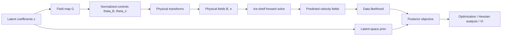

# schurflow

`schurflow` is a research code for PDE-constrained inverse problems in ice-shelf flow. It is designed for settings where you want to infer spatially varying material properties from observed velocity fields while keeping the forward physics, sensitivities, and uncertainty analysis in one place.

The current implementation is tailored to estimating ice-shelf rheology, especially rigidity `B` and Glen flow-law exponent `n`, from one or more epochs of observed surface velocity. More broadly, the package is useful for Earth scientists working on inverse problems with the same structure:

- represent an unknown field in a reduced basis or latent space
- solve a nonlinear forward model on a mesh
- compare predictions with observations through a likelihood
- combine that likelihood with prior information
- optimize or approximate the posterior over the unknown field

The active command-line workflow is now organized around four scripts:

- `scripts/optimize_MAP_joint.py` for MAP estimation
- `scripts/compute_hessian.py` for Hessian analysis and Laplace-style sampling
- `scripts/variational_inference.py` for the primary Gaussian VI path
- `scripts/hvi_optimize.py` for the hierarchical VI variant

Example configs live under `config/`. Each experiment now has:

- one inference config such as `config/config_sinusoidal.toml`
- one prep config such as `config/config_sinusoidal_prep.toml`

Both use explicit `extends = ...` inheritance so the default values are discoverable in the TOML files themselves.

## What The Core Code Provides

At a high level, `schurflow` gives you:

- matrix-based parameterizations for unknown spatial fields
- Gaussian priors in latent coefficient space
- a Firedrake/Icepack forward model for ice-shelf flow
- observation handling for multi-epoch velocity data
- adjoint-based gradients and Hessian-vector products
- MAP-style inverse problem building blocks
- full-rank variational Gaussian posterior approximations
- Schur-complement and Cramer-Rao style uncertainty analysis
- diagnostics for null spaces, prior dominance, and calibration

## Scientific Use Case

The code is written around a common glaciological inverse problem:

1. A mesh and ice thickness field define the forward domain.
2. Unknown rheological fields are represented in a reduced basis.
3. Those latent coefficients are mapped to normalized control fields.
4. The normalized controls are transformed into physical fields such as `B` and `n`.
5. An ice-shelf stress balance is solved to predict velocities.
6. Predicted and observed velocities are compared through a data misfit.
7. Prior and likelihood information are combined to form a posterior objective.
8. The posterior is explored with optimization, Hessian analysis, or variational inference.

If you work on similar problems involving basal traction, viscosity, damage, diffusivity, or other spatially varying control fields, the architecture should feel familiar even if the current physics is ice-shelf specific.

## Design Philosophy

The codebase is organized around a small number of core ideas.

### 1. Separate latent parameters from physical fields

Unknown fields are not optimized directly node-by-node. Instead, they are represented by latent coefficients in a basis matrix. This is useful when you want:

- dimension reduction
- smoother and more interpretable priors
- explicit control over spatial scales
- easier coupling between multiple inferred fields

### 2. Keep priors in coefficient space

Priors are defined on the latent coefficients, where regularization and cross-field coupling are easier to express. The coefficients are then mapped into spatial fields before the forward solve.

### 3. Keep the forward model and inverse model tightly coupled

The code uses Firedrake, Icepack, and pyadjoint to build the PDE-constrained part of the inverse problem. This allows the same core objects to provide:

- forward predictions
- data misfit evaluation
- gradients
- Hessian-vector products

### 4. Treat uncertainty quantification as a first-class part of the workflow

The repository is not only for finding one best-fit field. It also contains tools to:

- approximate posterior covariance
- fit full-rank Gaussian variational posteriors
- learn hierarchical prior hyperparameters
- diagnose when the inverse problem is strongly prior-dominated

## Conceptual Architecture

The central object model follows this flow:

- `fields.py` maps latent coefficients to control fields and defines priors
- `problems.py` defines the PDE problem, observations, and data misfit
- `objectives.py` combines priors and data into inverse-problem objectives
- `vi.py`, `hvi.py`, `schur.py`, and `diagnostics.py` sit on top of that core to quantify uncertainty

The active script path is intentionally thin:

- `config_utilities.py` loads, merges, and validates configs
- `workflow_utils.py` handles shared workflow bootstrap
- `train_utilities.py` builds the model objects and exports predictions
- the four scripts above contain only workflow-specific logic

## Core Modules

### `fields.py`

This module defines how unknown fields are represented.

- loads or accepts matrix operators that map latent coefficients to spatial fields
- supports single-field and joint two-field parameterizations
- defines prior precision matrices in coefficient space
- provides Jacobian-vector and vector-Jacobian products for latent-to-field maps

In practice, this is the bridge between "the parameters you infer" and "the fields the PDE solver uses."

### `models.py`

This module defines the ice-shelf constitutive and forcing terms used by the forward model.

- custom viscosity and rheology parameterizations
- terminus stress and gravity terms
- solver-option builders for Icepack/PETSc backends

This is where the glacier physics enters the inverse problem.

### `problems.py`

This is the main PDE problem definition.

- creates mesh-based function spaces
- loads observations from HDF5
- handles one or more observation epochs
- maps normalized controls into physical rheology fields
- runs the forward velocity solve
- defines the data negative log likelihood

This is the core "physics plus data" layer.

### `objectives.py`

This module wraps the field parameterization and the PDE problem into inverse-problem objectives.

- `DataObjective` evaluates the data misfit in latent space
- `PosteriorObjective` adds the prior term
- gradients are obtained through the adjoint machinery
- Hessian-vector products are exposed for second-order and uncertainty methods

This is the main interface for optimization and posterior approximation.

### `train_utilities.py`

Despite its name, this is really a core workflow utility module.

- builds the main objects from configuration and input data
- provides optimization helpers
- converts model outputs to gridded arrays
- generates saved prediction products from inferred parameters

### `config_utilities.py` and `workflow_utils.py`

These modules define the supported runtime path.

- `config_utilities.py` loads configs through explicit `extends` chains, applies CLI overrides, applies calibration or discovery overrides, and validates the final config contract
- `workflow_utils.py` resolves input and output filenames, restore stages, and shared workflow bootstrap for the active scripts

### `vi.py` and `hvi.py`

These modules provide Gaussian variational inference tools.

- `vi.py`: the primary full-rank Gaussian VI path in covariance form
- `hvi.py`: the optional hierarchical variant with learnable prior scales and cross-field correlation

These are useful when a Laplace approximation is too restrictive but you still want a tractable Gaussian family.

### `schur.py` and `schur_dense.py`

These modules provide uncertainty analysis based on Fisher blocks and Schur complements.

- separate information carried by different inferred fields
- marginalize nuisance blocks efficiently
- estimate field uncertainties and mode structure
- support both matrix-free and dense workflows

This is especially relevant when one field is of direct scientific interest and another field acts as a nuisance or compensating parameter.

### `diagnostics.py` and `stats.py`

These modules help answer the question: "How trustworthy is the inversion?"

- null-space and effective-dimensionality diagnostics
- prior-dominance checks
- suggestions for safer hierarchical priors
- calibration and coverage summaries for posterior samples

### Supporting utilities

Several smaller modules support the core workflow:

- `file_utilities.py`: HDF5 I/O, results-path helpers, and optimizer state persistence
- `utilities.py`: mesh-to-grid conversion and general helpers
- `adjoint_utils.py`, `adjoint_utils_mesh.py`, `jax_utilities.py`: derivative and operator utilities
- `strain.py`: strain-rate calculations from gridded velocity fields
- `noise_utils.py`: correlated noise generation for synthetic experiments

## What Data The Core Library Expects

The main abstractions assume a few standard ingredients.

### 1. A mesh

The forward model is solved on a Firedrake mesh.

### 2. Observation data

Observation files are expected in HDF5 form and typically contain:

- ice thickness `h`
- velocity observations `u`
- grid coordinates `x`, `y`
- a reference strain-rate magnitude `eps_ref`

Optional fields include:

- strain components
- temporal covariance information across epochs

### 3. A field parameterization matrix

The latent-to-field map is usually provided through matrix data stored on disk. This defines the reduced basis used for the unknown fields.

## Why This Design Is Useful

For many Earth-science inverse problems, the difficult part is not only computing a best fit. It is balancing:

- physical realism
- regularization
- computational cost
- interpretability
- uncertainty quantification

`schurflow` is built to keep those pieces connected. Rather than treating the inverse problem, posterior approximation, and identifiability checks as separate projects, it keeps them in the same object model.

That makes it easier to ask scientifically important questions such as:

- Which parts of the field are truly constrained by the data?
- Where are `B` and `n` compensating for each other?
- How much of the posterior precision comes from the prior rather than the observations?
- Are learned hyperparameters trustworthy, or is the problem too ill-posed?

## Dependencies And Environment

This is a research codebase, not a lightweight pip package. The core stack includes:

- Firedrake
- Icepack
- JAX
- Optax
- TensorFlow Probability for JAX
- MPI tools such as `mpi4py`
- HDF5 and geospatial I/O tools such as `h5py` and `rasterio`

The code also depends on companion packages such as `cryogen` and `jbao`, which provide supporting utilities and matrix-building functionality.

## Current Scope

The present code is most mature for ice-shelf rheology inversion with spatially varying rigidity and flow-law exponent. The abstractions are general enough to be useful elsewhere, but many conventions, data fields, and helper routines are currently glaciology-specific.

If you are approaching this code from another Earth-science inverse problem, the main pieces to look at first are:

- `fields.py`
- `problems.py`
- `objectives.py`
- `vi.py` or `hvi.py`
- `schur.py`

These files contain the main design ideas of the repository.
